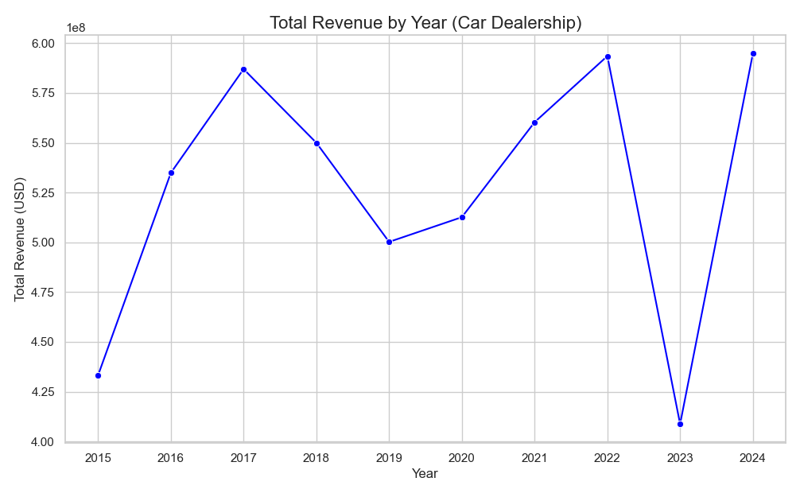

# Car Dealership Sales — Revenue Analysis

A small Python data-analysis exercise from my IBM Data Analyst certification. It loads a car-dealership sales dataset and charts total revenue by year.

**View the analysis:** [CarSalesNoteBk.ipynb](CarSalesNoteBk.ipynb) (GitHub renders it in the browser) · [Chart](carsalespython.png)



## Dataset

`sample dataset.xlsx`: 250 rows, 2015–2024. Columns: `Year`, `Car_Model`, `Dealership_Location`, `Units_Sold`, `Average_Price`, `Total_Revenue`.

It covers five models (Sedan, SUV, Truck, Coupe, Convertible) across five US locations (New York, Los Angeles, Chicago, Houston, Miami). The figures appear to be synthetic sample data.

## Findings

- Total revenue across the decade: about **$5.28B**
- Revenue ranged from about $409M (2023, the lowest year) to about $595M (2024, the highest)
- Top model by revenue: **Truck** (~$1.13B), with Coupe and SUV close behind; Sedan was lowest (~$0.89B)
- Top location: **Chicago** (~$1.22B)

The notebook and script chart revenue by year only. The model and location figures above come from the same dataset.

## Files

| File | Purpose |
|---|---|
| `CarSalesNoteBk.ipynb` | Notebook: load data, aggregate revenue by year, line chart |
| `carsalespython.py` | The same analysis as a standalone script |
| `carsalespython.png` | Output chart |
| `sample dataset.xlsx` | Source data |

## Run

```bash
pip install pandas openpyxl matplotlib seaborn
python carsalespython.py
```

## Tools

Python · pandas · Matplotlib · seaborn · Jupyter

## Author

[William Thompson](https://github.com/yooku98)
